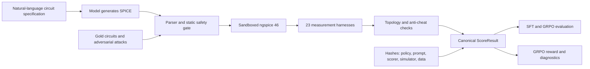

# PhyChip — interview summary

Use this file to explain the project at three depths: a 30-second introduction,
a 2-minute technical story, and a detailed discussion. Do not memorize every
number. Memorize the claim boundary, the architecture, three results, and three
lessons.

## How to use this before the interview

If you have 30 minutes:

1. Say the 30-second and two-minute answers aloud.
2. Redraw the system picture from memory.
3. Practice “Did RL work?”, “How did you prevent reward hacking?”, and “What
   did you do wrong?”
4. Pick two STAR stories that fit the role.
5. Review the numbers-to-memorize table once, then stop.

If you have only 10 minutes, memorize the one-sentence positioning, the three
clean-SFT scores, the 3/53-to-6/53 inconclusive RL result, and why seed 42 was
rejected.

## The one sentence to remember

**PhyChip is a verifier-first reinforcement-learning research project: I built
an Apache-2.0 environment that runs model-generated analog circuits in a
sandboxed, pinned ngspice simulator and converts physical measurements into an
auditable reward; the 3B circuit model is the proof case, not the main product.**

That positioning matters. The strongest artifact is `phy-chip-env` and the
methodology around trustworthy physics rewards. The current model is an honest,
limited research preview.

## My 30-second answer

> I wanted to test whether reinforcement learning with verifiable rewards could
> improve a small language model on a real engineering task, not another math
> benchmark. I chose analog circuit design because a generated SPICE netlist can
> be executed and measured by a physics simulator. I trained a 3B model with
> clean supervised fine-tuning, then investigated group-relative RL using
> ngspice as the reward oracle. The most important result was not a claimed RL
> win. It was a production-style verifier: 23 circuit harnesses, sandboxed
> execution, one canonical scorer, reward-hacking regression tests, artifact
> fingerprints, and 175 passing package tests. The work also showed exactly why
> small RL experiments can look successful while actually measuring prompt
> mismatch, simulator drift, duplicated data, or verifier exploits.

## My 2-minute answer

> PhyChip started as a five-stage model-training plan: physics continued
> pretraining, semiconductor continued pretraining, SFT, DPO, and RLVR. I did
> not keep the plan just because it looked sophisticated. Controlled ablations
> showed that continued pretraining at my LoRA and token scale hurt an already
> healthy SFT model by about 5 percentage points, and DPO did not add measurable
> value. The load-bearing pipeline therefore became clean SFT followed by a
> carefully bounded RL investigation.
>
> The clean SFT corpus began with 23,026 rows. Static checks kept 16,177 and
> sandboxed ngspice validation kept 15,660. The run used two epochs, 1,958
> optimizer steps, and 20.42 million tokens. It scored 21/24 on an AnalogCoder
> raw-SPICE proxy, 23/40 on bench-v1, and 25/46 on bench-v2. Those results are
> useful but narrow: almost all successes are Level 1, and general-capability
> non-inferiority was not established.
>
> For RL, I used GRPO because it compares several completions for the same prompt
> and does not need a learned critic. The implemented recipe is best described
> as Dr.GRPO plus selected DAPO components: eight rollouts per group, no reward
> standard-deviation scaling, DAPO token loss, asymmetric clipping, two policy
> updates per group, no KL penalty, real EOS handling, truncation masking, and
> policy loss only on executable SPICE tokens. Most importantly, a prompt was
> admitted only when the current policy produced both successes and failures at
> K=8, because an all-fail or all-pass group provides no useful relative signal.
>
> I do not claim that RL beat SFT. The matched rank-64 result moved from 3/53 to
> 6/53, but its confidence interval crossed zero and McNemar p was .375. A later
> seed completed 140 updates but failed a frozen entropy gate, and manual review
> found a new verifier escape, so I rejected the adapter before comparative
> evaluation. That is the deeper engineering result: in RLVR, the verifier is
> part of the learning algorithm. If its semantics are wrong, the gradient is
> wrong.
>
> I then used 384 frozen current-policy rollouts as an adversarial verifier
> audit. Complete review found 46 invalid positive-reward rows under scorer v8.
> After test-first remediation, scorer v9 retained 11 safe mixed-success prompts
> across 7 families and 18 exact successes, with zero known-invalid circuits on
> the final reward frontier. That validates the data contract, not the RL
> thesis. I still need to scale to 150--250 references before training.

## The system in one picture



The key design choice is one reward semantics across labeling, training,
evaluation, rescoring, and the standalone package. The training and packaged
source trees have separate fingerprints, so exact-corpus parity tests bridge
them; the fresh pilot matched on all 96 rollouts. There is no untested separate
“training reward” that can silently drift away from the reported metric.

## What problem I was solving

Most language-model post-training uses one of two common signals:

- a fixed demonstration written by a human or teacher; or
- a learned preference model that can itself be biased or gamed.

RL with verifiable rewards, or RLVR, replaces the learned reward model with a
deterministic programmatic check. Math can use an answer checker; code can use
tests; PhyChip uses circuit simulation and physical measurements.
`[[wiki: RLVR]]`

Analog design is a useful proof case because correctness is not just syntax.
The netlist must parse, simulate, have the intended topology, and meet measured
targets such as gain, bandwidth, threshold, current, or output voltage. It is
also difficult enough to expose the difference between “the simulator ran” and
“the engineering design is valid.”

## What I built

### 1. `phy-chip-env`

The public-facing artifact is an Apache-2.0 Python package with one canonical
interface:

```python
score(circuit_id, target_specs, completion) -> ScoreResult
```

`ScoreResult` explains the score rather than returning only a scalar. It records
whether parsing and simulation succeeded, whether an anti-cheat rule blocked
the output, how many requested metrics were measured and met, the normalized
spec score, exact success, structural diagnostics, and runtime information.

The package contains:

- 23 circuit-specific measurement harnesses;
- a pinned ngspice-46 requirement;
- sandboxed execution with time, CPU, memory, output, file, and process limits;
- privilege dropping when launched as root;
- gold-reference, adversarial, timeout, clean-install, and scorer-parity tests;
- a capability matrix that states what each verifier checks and does not check;
- a reward contract that distinguishes partial shaping from scientific
  success.

The standalone package's last full suite has 175 passing tests. That gate checks
44/53 corrected historical references, 22 known attacks, timeout behavior, and
parity on 106 retained completions. Nine stale gain-trim references were
quarantined because trim changed output offset but not gain. Scorer v9 also
passed deterministic replay of a 384-rollout pilot and a complete manual review
of its reward frontier. Final manifest regeneration is the immediate release
blocker.

### 2. A clean-SFT pipeline

The data path is deliberately fail-closed:

| Stage | Rows | Meaning |
|---|---:|---|
| Source corpus | 23,026 | Raw collected/generated training rows |
| Static-valid | 16,177 | Tokenizer, template, schema, and static checks passed |
| Dynamic-valid | 15,660 | Sandboxed ngspice simulation passed |
| Dynamic quarantine | 517 | Passed static checks but failed the production sandbox gate |

The final SFT run used:

- `HuggingFaceTB/SmolLM3-3B-Base`;
- LoRA;
- two epochs and 1,958 optimizer steps;
- 20.42M processed tokens;
- final training loss 0.4677;
- assistant-token accuracy 0.9394.

Loss and token accuracy are optimization diagnostics, not evidence that the
model designs correct circuits. The simulator-backed evaluations are the
quality evidence.

### 3. A verifier-first GRPO stack

GRPO generates a group of completions for the same prompt, scores them, and
reinforces completions that perform better than the group baseline. This avoids
training a separate value model or critic. `[[wiki: GRPO]]`

The current bounded recipe implements:

| Component | PhyChip setting | Why |
|---|---|---|
| Group size | K=8 | Creates within-prompt comparisons |
| Temperature | 0.9 in training | Produces enough policy diversity to expose a mixed-success band |
| Critic | None | GRPO uses the group-relative baseline |
| Reward scaling | `scale_rewards=False` | Dr.GRPO-style removal of group standard-deviation rescaling |
| Loss | `loss_type="dapo"` | Token-level DAPO loss |
| Clip higher | `epsilon_high=0.28` | Allows asymmetric positive clipping |
| Reuse | `num_iterations=2` | Makes clipping meaningful and gives two updates per rollout group |
| KL penalty | `beta=0` | Deliberate bounded verifier-RL choice, not a universal rule |
| Truncation | Mask truncated completions | Avoids reinforcing incomplete, capped generations |
| Completion ceiling | 3,072 tokens plus real chat EOS | A safety and cost boundary; “unlimited tokens” is not safe or useful |
| LoRA | rank 64, alpha 64 | Enough adapter capacity for the bounded study; rank 128 is not supported by evidence |
| Optimizer | LR `1e-5`, cosine decay, 5% warmup | Conservative policy movement after SFT |

This is **not full DAPO**. Native online drop-and-resample dynamic sampling, the
soft overlong reward schedule, asynchronous inference/training, and a verl-style
distributed runtime are not implemented. The accurate phrase is “Dr.GRPO plus
selected DAPO components.”

## The reward is a contract, not just a number

For a normalized specification score `s` between 0 and 1, the current reward
semantics are:

```text
malformed, unsafe, non-simulating, or family-invalid  -> 0
valid measured specification progress                -> 0.70*s
all requested specifications met                     -> 1.30
```

Parsing and simulation progress remain diagnostics, but receive no reward;
**scientific success is always `all_specs_met`**, never “reward above some
threshold.” Missing or invalid measurements remain in the denominator and
receive zero credit.

Why gate the reward? A linear sum lets superficial quality compensate for
incorrectness. For example, a beautifully formatted netlist that simulates but
clamps the output with an independent source is still wrong. Auxiliary shaping
is therefore paid only after the sandbox, topology, anti-cheat, and measurement
contracts pass.

## How I addressed reward hacking

Reward hacking means the policy increases the measured reward without doing the
intended task. In verifier RL, the important question is not “does the reward
increase?” but “what behavior sits on the high-reward frontier?”
`[[wiki: Reward Hacking]]`

I preserved generations, manually inspected high-reward winners, and converted
each discovered failure into a regression test. Representative failures were:

| Failure | Why it fooled a weak scorer | Defense |
|---|---|---|
| Independent source at `Vout` | Directly forced the measured answer | Reject output-driving independent sources |
| Positive feedback in an amplifier | AC magnitude looked plausible while loop polarity was wrong | Structural polarity checks plus signed-gain measurements |
| Decorative Schmitt feedback | Feedback-looking parts did not affect the output stage | Require the output-driving stage to consume the feedback node |
| Equal Schmitt thresholds | Ordinary comparator presented as hysteresis | Require finite `vth_high > vth_low` |
| Hidden internal `AC 1` source | Made the named input irrelevant | Permit stimulus only at the declared input source/node |
| False comments | Executable circuit and prose disagreed | Exclude comments and prose from policy loss |
| Repeated comments until the cap | Exploited termination and length handling | Real EOS, finite cap, truncation masking |
| Train/eval prompt mismatch | Optimized one interface and evaluated another | One shared byte-identical renderer plus prompt hash |
| Multi-hop resistor feedback escape | A three-resistor path bypassed a direct/one-hop rule | Scorer-v7 graph traversal with safe-node constraints |

The subtle lesson is that a new anti-cheat rule can also reject correct circuits.
The first transitive feedback-path fix overblocked four valid resistor-fed
subcircuits. The full 129-reference gold gate caught that false negative, and I
narrowed the rule before accepting scorer-v7. A verifier needs both adversarial
tests and a broad valid-reference suite.

## Why the policy loss is selective

For SFT, “response-only loss” means the prompt tokens are masked and the model
learns only from assistant response tokens.

For RL, that was still too broad. One scalar reward is assigned to a complete
sequence. If a circuit is correct but its comment contains a false claim, a
normal sequence-level update reinforces both the executable circuit and the
false comment.

PhyChip therefore keeps the entire completion in context but applies policy
loss only to:

- the SPICE fence;
- executable non-comment lines;
- required line separators;
- the closing fence; and
- the real assistant EOS token.

Outside-fence prose, full-line comments, `.title` prose, and inline comments are
masked. Malformed outputs keep an all-token negative mask so the policy can
still suppress the failure. This is targeted credit assignment, not a claim
that the model can no longer emit comments.

## How RL data is selected

A GRPO group needs relative reward variation. If all eight outputs fail, their
advantages are all zero. If all eight succeed with the same reward, the group
is also uninformative.

PhyChip measures difficulty with the exact current policy and scorer:

```text
trainable(prompt) := 0 < pass_count(current_policy, prompt, K=8) < 8
```

Every label is bound to the policy hash, prompt hash, scorer version, verifier
hash, sampling configuration, and success/reward vector. Changing the scorer
invalidates the labels; they are never silently relabeled.

The historical scorer-v6 audit contained:

| Quantity | Value |
|---|---:|
| Candidate prompts | 144 |
| Rollouts | 1,152 |
| Exact successes | 135 |
| Mixed-success prompts | 70 |
| Observed zero-success prompts | 74 |
| Capped completions | 12 |
| Unique topology fingerprints in the 70 mixed rows | 52 |

The data had usable signal, but it was not sufficient for a generalization
claim. Sixty-nine of the 70 mixed prompts were amplifier-family rows, one was a
Sallen-Key filter, and none was a Schmitt trigger. Thirty-eight prompts had only
one success in eight. More optimizer steps over those same 70 rows would mostly
increase reuse, not task diversity.

The fresh scorer-v7 pilot made the gate stricter. Twelve references across 12
families produced 96 current-policy rollouts: machine scoring found 5 mixed,
7 observed 0/8, and 0 at 8/8. Manual review rejected a wrong-family buffer and
a transitive gain-trim alias among the six exact winners, leaving only 3 safe
mixed prompts across 3 families. I stopped before training. This is the cleanest
example of why “balanced data” is an observed, semantically audited property,
not a ratio I can manufacture in a dataset file.

The 48-reference follow-up produced 384 rollouts. Complete scorer-v8 review
found 46 invalid positive-reward rows, including 38 with positive advantage.
After test-first scorer-v9 remediation, deterministic replay retained 11 safe
mixed prompts across 7 families, 18 exact successes, 37 observed 0/8 prompts,
and no 8/8 prompt. All 33 v9 group winners were reviewed with zero known-invalid
frontier rows. This validates the contract; it does not make 11 prompts a
decisive training curriculum.

The next count is evidence-based. Sixteen to 32 safe mixed prompts are only a
pipeline smoke. The first bounded causal study targets 150--250 prompts across
8--12 families and at least 100 topology fingerprints. A real attempt at the
generalization thesis needs 500+ training prompts plus a sealed 300--500-prompt
topology/numeric-disjoint holdout. The next action is to scale the unchanged v9
contract to 150--250 new references and freeze the holdout before training.

## Results I can defend

### Clean SFT is the release candidate

| Evaluation | Clean SFT | What it establishes |
|---|---:|---|
| AnalogCoder raw-SPICE proxy | 21/24 | Strong Level-1 circuit-generation floor; not the official AnalogCoder evaluation |
| bench-v1 | 23/40 | 23/23 Level 1, 0/17 Levels 2–3 |
| bench-v2 | 25/46 | 24/28 Level 1, 1/13 Level 2, 0/5 Level 3 |
| Physics-MMLU | 356/785 vs base 365/785 | Delta -1.15 pp; paired CI [-3.31,+0.89] pp; non-inferiority not established |

The benchmark wording is part of the evidence. AnalogCoder is externally
sourced but locally adapted from plan-plus-PySpice into raw SPICE plus ngspice.
Bench-v1 and bench-v2 are simulator-backed, model-assisted project benchmarks.
Their row identities match the released sets,
but they are not independent external replications and their scores should
never be averaged.

### The Qwen control exposed a metric gap

The same-data Qwen3.5-4B SFT control scored 20/24, 21/40, and 24/46. The
matched Smol control scored 23/24, 23/40, and 23/46. Across all 110 automatic
rows, Smol led 69 to 65. This was a separate matched high-cap comparison, not
the 2,560-token primary release contract, so its 23/24 Smol result must not
replace the primary 21/24 claim.

Manual topology plausibility reversed the comparison: Qwen led 53/110 to
38/110. This means simulator-backed automatic success is necessary but not
sufficient for engineering quality. It motivated keeping topology review and
the capability matrix explicit rather than presenting one aggregate score as
the whole story.

### RL remains unanswered, not disproved

| RL evidence | Result | Correct interpretation |
|---|---:|---|
| Corrected historical GRPO-v3 | 16/24, 19/40, 10/46 | Rejected candidate from a different SFT parent; not a causal SFT-to-RL comparison |
| Matched rank-64 smoke | 3/53 -> 6/53 | +5.66 pp, 95% CI [-1.89,+13.21] pp, McNemar p=.375; inconclusive |
| Scorer-v6 powered seed 42 | 70 groups, 560 rollouts, 140 updates | Rejected diagnostic: entropy minimum 0.1486 crossed the frozen 0.15 floor and one invalid winner exposed a verifier bug |

The honest statement is:

> I have not yet run a thesis-grade experiment that can establish whether RLVR
> improves out-of-distribution circuit generalization. The completed work proves
> that the environment produces discriminating reward and that the experimental
> contract can fail closed when that reward is invalid.

That is stronger than calling every non-significant run a “null.” A null result
requires a valid, adequately powered experiment. Several historical runs were
confounded by completion-versus-chat prompts, missing EOS, 100% length caps,
simulator-version drift, or stale verifier semantics.

## What I did wrong, and how I corrected it

This is a strong interview section because it shows scientific judgment.

### 1. I treated the five-stage plan as the product

The original pipeline looked impressive but was not evidence-based. CPT hurt a
healthy SFT model by about 5 pp at the tested scale, and DPO was neutral or
unstable. I removed them from the load-bearing path instead of defending sunk
cost.

**General lesson:** ablations should decide architecture; the roadmap should
not decide the result.

### 2. I trusted successful simulation too much

A circuit can simulate and still be invalid: it can clamp the output, ignore
the named input, use decorative feedback, or exploit an incomplete graph check.
The manual high-reward audit found exactly this class of failure.

**General lesson:** in RLVR, verifier precision is model quality. Every false
positive becomes positive gradient.

### 3. I initially mixed experimental contracts

Earlier training used completion-format prompts while evaluation used chat
format. Another run never emitted EOS, so all rollouts hit the length cap. A
simulator-version difference also changed circuit outcomes.

**General lesson:** prompt renderer, EOS, simulator binary, scorer, and model
must be fingerprinted as one experimental identity.

### 4. I underpowered the RL comparison

The 53-spec rank-64 smoke had a positive point estimate but a wide confidence
interval. It could not answer the question. More training alone would not fix a
small, narrow evaluation set.

**General lesson:** power the measurement, not only the optimizer.

### 5. I underestimated effective data diversity

The clean SFT corpus has 15,660 rows, but 7,537—48.1%—share one normalized
netlist template. The RL mixed band has 70 prompts but only 52 topology
fingerprints and is overwhelmingly amplifier-family data.

**General lesson:** row count is not design diversity. Count families,
topologies, objective combinations, and policy-observed success bands.

### 6. I learned to reject my own trained adapter

The powered seed completed successfully at the infrastructure level. I still
rejected it because a preregistered entropy floor failed and a manual reward
audit found an invalid winner.

**General lesson:** a completed training job is not a completed experiment.

## What is technically distinctive

I would emphasize these contributions in an interview:

1. **Environment-first framing.** The reusable contribution is a physics-backed
   RLVR environment; analog generation is the proof case.
2. **One canonical scorer.** Labeling, RL reward, evaluation, rescoring, and the
   package share the same versioned semantics.
3. **Measured trainability.** Difficulty is defined by current-policy K=8
   outcomes, not by a human label such as “easy.”
4. **Selective policy loss.** The model sees the full response but receives
   gradient only on executable SPICE and EOS.
5. **Verifier red teaming before and after training.** Gold cases protect
   recall; adversarial cases protect precision; live rollouts discover attacks
   neither suite anticipated.
6. **Fail-closed provenance.** Policy, prompt, simulator, scorer, verifier, and
   dataset hashes travel with labels and results.
7. **Claim discipline.** A useful environment result is not silently upgraded
   into a model-generalization result.

## What is not novel or not established

Be direct if an interviewer asks:

- GRPO, Dr.GRPO, DAPO, LoRA, SPICE, and ngspice are existing techniques.
- PhyChip does not claim to have invented physics-based circuit optimization.
- The current work does not establish that the 3B model beats a strong circuit
  designer or a frontier agent.
- It does not establish physics-MMLU non-inferiority.
- It does not establish that RL beats SFT or generalizes OOD.
- The current simulator and structural checks are not formal circuit proofs.
- The subprocess sandbox is defense in depth, not a full kernel sandbox with
  seccomp, network namespaces, and mount namespaces.
- The model weights and data have a research/education
  CC-BY-NC-SA-4.0 posture; only the environment and pipeline code are
  Apache-2.0.

## How I would design the decisive next experiment

The next study should not simply train longer on the same 70 prompts.

### Data

- Scorer v8 is promoted and source/release tests are green. Rerun a fresh-ID
  48-reference pilot under that exact scorer.
- Scale only if at least 8 manually safe mixed prompts span 6 families with
  zero observed high-reward exploits; then target 150–250 mixed prompts.
- Set explicit quotas by circuit family, topology fingerprint, and objective.
- Cap repeated topologies.
- Bootstrap families with zero current-policy coverage using verified
  rejection sampling or high-quality teacher proposals, while keeping ngspice
  as the only label authority.
- Build a holdout with disjoint numeric ranges and meaningful topology shifts,
  not just different wording.

### Experimental arms

1. Frozen SFT/no-update baseline.
2. Rejection-SFT on current-policy verified winners.
3. Real-reward GRPO with at least three seeds.
4. Random-reward GRPO control.

The rejection-SFT arm answers an important alternative explanation: perhaps
verified on-policy winners improve the model, but policy gradient is not the
reason.

### Evaluation

- Treat specification as the statistical unit.
- Report K-sampled pass@1 as the primary outcome and greedy pass@1 as secondary.
- Report pass@8 coverage to show whether the policy can produce any solution.
- Use paired per-spec deltas and specification-cluster bootstrap confidence
  intervals.
- Require real-reward seeds to agree in direction.
- Manually audit every new winner and every baseline/RL discordance.
- Keep a general-capability retention suite.

### Promotion rule

Promote an RL result only if:

- scorer and environment gates remain green;
- the effect is positive with a confidence interval that supports the planned
  claim;
- real-reward seeds agree;
- the random-reward control does not reproduce the lift;
- the result survives topology-aware manual review; and
- general capability does not regress beyond a preregistered tolerance.

## Questions I expect in an interview

### Why did you use GRPO instead of PPO?

PPO normally needs a learned critic/value function in addition to the policy,
reference, and reward stack. GRPO estimates a relative baseline from multiple
responses to the same prompt, so it is simpler and more memory-efficient for a
3B verifier-RL experiment. The tradeoff is that it needs useful reward variance
inside each group. That requirement is why the current-policy mixed-success
gate is so important. `[[wiki: GRPO]]`

### What is Dr.GRPO?

Standard group-relative normalization can divide advantages by the group
reward standard deviation, which changes the scale of updates according to the
particular group. The Dr.GRPO-style setting disables that reward scaling with
`scale_rewards=False`. It does not solve bad rewards or missing data; it only
changes how useful reward differences are normalized.

### Did you implement DAPO?

Only selected components. I implemented DAPO token loss, clip-higher,
multiple policy iterations, and truncation masking. I did not implement native
online dynamic resampling, the soft overlong penalty schedule, or an
asynchronous distributed DAPO system. I call the recipe “Dr.GRPO plus selected
DAPO components,” not full DAPO.

### Why no KL penalty?

This bounded verifier-grounded run set `beta=0` to let the policy move without
an explicit reference penalty, while using clipping, a short schedule, health
gates, and manual audits as safeguards. That is an experimental choice, not a
claim that KL is always unnecessary. If capability retention or entropy drift
became the binding risk, KL-on would be a valid ablation.

### Why not increase the LoRA rank?

Rank 64 already targets the attention and MLP projections. The matched smoke
moved from 3 to 6 successes, so the adapter was capable of changing behavior,
but the experiment was statistically inconclusive. The stronger blockers were
reward validity, 70 narrow prompts, family imbalance, and evaluation power.
Rank 128 cannot repair those problems, so I would change rank only after a
controlled saturation ablation.

### Why not remove the output-token limit?

Generation must have a finite memory, latency, and denial-of-service boundary.
The historical problem was not that a cap existed; it was that the model failed
to emit EOS and every rollout hit the cap. The fix was a correct chat EOS,
3,072-token ceiling, cap-rate monitoring, and no policy loss on truncated
completions. Unlimited output would make both training and the simulator
pipeline less safe.

### Is loss computed on the prompt?

No for clean SFT: prompt tokens are masked and loss is computed on assistant
response tokens. RL is narrower still: the full response remains in context,
but policy loss is applied to executable SPICE tokens and EOS, while comments
and prose are masked.

### Why not make the batch much larger?

The important RL unit is the K=8 group, not just an SFT-style batch. Larger
batches increase rollout memory and generation cost and can reduce the number
of fresh policy updates for a fixed budget. This workload is generation- and
simulation-bound, so filling VRAM is not the same as maximizing scientific
throughput. I would tune batching from measured utilization and step time while
preserving current-policy freshness and group semantics.

### How did you know the reward had a useful gradient?

I logged both total reward variance and exact-objective/spec-score variance for
complete K=8 groups. In the powered seed, all 70 groups had total reward
variance and 54/70 had exact-objective variance. That showed the scorer was not
flat. It did not prove the reward was semantically valid—the manual audit later
found one invalid positive-advantage winner—which is why both diagnostics are
needed.

### Did RL work?

The only accurate answer is: **not established**. A matched smoke had a positive
point estimate but wide uncertainty. A later, healthier run was rejected by a
frozen entropy gate and a newly found verifier exploit before comparative
evaluation. I can defend the environment and the SFT baseline. I cannot yet
defend an RL generalization claim.

### What would make this publishable even if RL is null?

The environment itself is publishable engineering: a packaged, sandboxed,
versioned, adversarially tested physics verifier with documented failure modes.
A well-powered null would also be scientifically useful if the reward contract,
controls, and evaluation are valid. “RL did not outperform rejection-SFT on
this model and task band” is a meaningful result; an underpowered or exploitable
run is not.

### Why did automatic and manual Qwen/Smol rankings disagree?

The automatic scorer measures whether the output passed the encoded simulator
and spec contracts. Manual topology review asks whether the circuit looks like
a plausible implementation of the requested design. A proxy can have high
precision on known attacks and still miss broader engineering quality. The
disagreement is evidence that both measurements are necessary.

### How did you make the work reproducible?

I pinned the base revision, adapter chain, prompt template, scorer semantics,
verifier hash, ngspice banner, dataset hash, sampling parameters, and artifact
hashes. Cached results are reused only when identities match. I also built the
wheel, installed it outside the repository, and verified gold, attack, timeout,
and parity behavior from that clean environment.

### What would you do differently from day one?

I would begin with the smallest end-to-end contract: one model, one prompt
renderer, one simulator version, one scorer, full completion retention, and an
adversarial test suite. I would measure unique topology diversity before SFT,
compute the minimum detectable effect before RL, and include rejection-SFT and
random-reward controls from the first serious run.

## Four STAR stories

Use these as frameworks, not scripts. Keep only claims you personally can
explain and defend.

### Story 1 — I rejected a completed training run

**Situation:** A GRPO seed completed 70 groups, 560 rollouts, and 140 updates.

**Task:** Decide whether it was valid evidence worth evaluating and promoting.

**Action:** I applied a frozen health gate, inspected entropy and reward
components, and manually reviewed all 560 generations. The entropy minimum fell
below the preregistered floor, and one positive-advantage winner used a
three-resistor positive-feedback path that scorer-v6 did not detect. I stopped
seed 7, skipped comparative evaluation, versioned scorer-v7, and invalidated the
old labels.

**Result:** I avoided turning an exploitable reward into a model claim. The run
became verifier-debugging evidence, and the discovered exploit became a
regression test.

### Story 2 — I removed stages from my own roadmap

**Situation:** The project was designed as a five-stage post-training stack.

**Task:** Determine which stages actually improved the model under the available
data and compute budget.

**Action:** I ran controlled ablations with a common evaluation contract.
Physics CPT hurt a healthy SFT checkpoint by about 5 pp at the tested scale,
while DPO added no stable incremental value.

**Result:** I simplified the load-bearing path to clean SFT plus a bounded RLVR
study and redirected effort to the environment, data quality, and evaluation.

### Story 3 — A simulator-version bug changed the scientific conclusion

**Situation:** The same adapter appeared to score differently between machines.

**Task:** Determine whether the model had regressed or the environment had
changed.

**Action:** I compared the exact execution contracts and found ngspice-36 versus
ngspice-46 drift. I pinned version 46, added runtime checks and fingerprints,
and rescored results under one environment.

**Result:** I retracted the invalid model-regression interpretation and made the
simulator version part of every evidence record.

### Story 4 — A bigger row count hid low diversity

**Situation:** The clean corpus contained 15,660 simulator-passing rows, but the
model remained almost entirely Level-1 capable.

**Task:** Explain why more training data had not produced broader design skill.

**Action:** I normalized netlists and measured template/topology diversity. One
template cluster accounted for 7,537 rows, and the RL mixed band was similarly
concentrated in amplifier families.

**Result:** I changed the next-study plan from “more epochs” to explicit
family/topology quotas, repeated-fingerprint caps, and disjoint topology/numeric
holdouts.

## Resume-style bullets

Choose two or three, then tune them to the role:

- Built `phy-chip-env`, an Apache-2.0 RLVR environment that converts sandboxed
  ngspice-46 circuit simulations into versioned, decomposed rewards across 23
  analog-circuit harnesses; validated with 175 tests, 22 adversarial cases,
  timeouts, corrected-reference preservation, and package/repository parity.
- Curated a 23,026-row circuit corpus into 15,660 simulator-validated SFT
  examples and trained a SmolLM3-3B LoRA model for 1,958 steps/20.42M tokens,
  reaching 21/24 on a raw-SPICE proxy and 25/46 on a simulator-backed benchmark.
- Implemented a verifier-first GRPO stack with K=8 current-policy difficulty
  labeling, Dr.GRPO no-scaling, selected DAPO components, executable-token
  policy loss, provenance-bound labels, and paired bootstrap evaluation.
- Red-teamed physics rewards against output clamping, unused inputs, decorative
  feedback, hidden stimuli, repetition, prompt drift, and multi-hop topology
  exploits; converted discoveries into fail-closed scorer versions and
  regression tests.
- Designed statistically honest model comparisons with matched parents,
  per-spec paired deltas, bootstrap confidence intervals, random-reward and
  rejection-SFT control plans, and explicit rejection gates for invalid runs.

## Numbers worth memorizing

| Number | Meaning |
|---:|---|
| 3B | Primary SmolLM3 base size |
| 23 | Circuit measurement harnesses |
| 164 | Standalone environment tests |
| 23,026 -> 15,660 | Raw SFT rows -> sandboxed simulator-valid rows |
| 20.42M | SFT tokens processed |
| 1,958 | SFT optimizer steps |
| 21/24 | Clean SFT AnalogCoder raw-SPICE proxy |
| 23/40 | Clean SFT bench-v1 |
| 25/46 | Clean SFT bench-v2 |
| 7,537 / 15,660 | Rows in one repeated normalized template cluster |
| K=8 | GRPO rollouts per prompt |
| 70 / 144 | Historical mixed-success prompts / candidates |
| 52 | Unique topology fingerprints among those 70 mixed prompts |
| 5 machine -> 3 safe | Fresh scorer-v7 mixed prompts after manual review |
| 96 / 96 / 0 | Fresh pilot rollouts / real EOS / capped |
| 150--250 | Safe mixed prompts for the first bounded causal study |
| 500 + 300--500 | Generalization-study training target + sealed holdout |
| 3/53 -> 6/53 | Matched rank-64 RL point estimate |
| p=.375 | Why that matched result is inconclusive |
| 560 / 140 | Powered seed rollouts / optimizer updates |
| 0.1486 < 0.15 | Frozen entropy gate failure |

## Five lines to avoid

Do not say:

1. “I built a state-of-the-art circuit-design model.”
2. “GRPO improved generalization.”
3. “The model scored 21/24 on official AnalogCoder.”
4. “The sandbox makes arbitrary SPICE perfectly safe.”
5. “I implemented full DAPO.”

Say instead:

1. “I built a rigorous physics-verifier environment and a limited 3B proof-case
   model.”
2. “The RL question remains unestablished; I can explain exactly why.”
3. “It scored 21/24 on our raw-SPICE AnalogCoder proxy.”
4. “The subprocess sandbox is defense in depth, with explicit residual limits.”
5. “The recipe combines Dr.GRPO with selected DAPO components.”

## Final interview checklist

Before the interview, make sure you can explain without this file:

- why the environment is the product;
- how a generated netlist becomes a `ScoreResult`;
- why “simulated” is not the same as “correct”;
- why GRPO needs mixed-success K-groups;
- the difference between SFT response-only loss and executable-token RL loss;
- one reward hack and the exact defense;
- why the rank-64 result is inconclusive;
- why the powered seed was rejected;
- the clean-SFT result and its Level-2/3 limitation;
- the next experiment and its controls.

Also be precise about personal ownership. AI tools can accelerate code, data
review, and documentation, but in an interview you should claim only the design
decisions, implementation details, experiments, and reviews that you can walk
through line by line. The strongest answer is not “I did everything manually”;
it is “I set the contracts, verified the evidence, and rejected outputs that did
not meet them.”

## Where to go deeper in the repository

| Topic | Source of truth |
|---|---|
| Current project state | `README.md` |
| Complete post-training design | `posttraining.md` |
| Frozen result claims and hashes | `release/v0.1/EVIDENCE.md` |
| Release technical story | `release/v0.1/TECHNICAL_NOTE.md` |
| Environment usage | `phy-chip-env/README.md` |
| Exact reward semantics | `phy-chip-env/docs/REWARD_CONTRACT.md` |
| Per-circuit verifier coverage | `phy-chip-env/docs/CAPABILITY_MATRIX.md` |
| Reproduction | `REPRODUCE.md` |
| Current unresolved work | `pending.md` |
